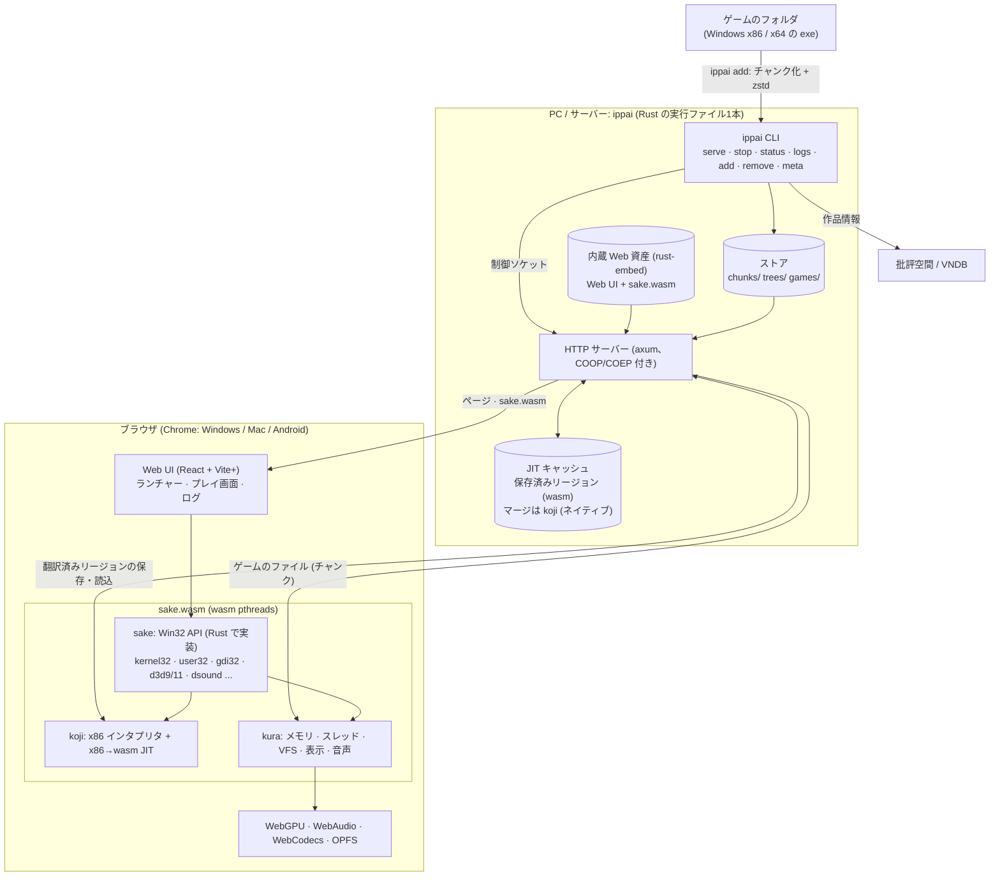

# ippai

ビジュアルノベルをブラウザの中で動かすためのリポジトリです。ゲームの x86 (i386) コードはx86→wasm JIT (`crates/koji`) で動かし、Windows API は Rust で一から書いた Win32 層sake (`crates/sake`、[docs/sake.md](docs/sake.md)) が受け持ちます。表示・音声・ファイル・Direct3D/OpenGL (WebGPU) はブラウザ側のホスト `crates/kura` です。

## アーキテクチャ



- ゲームの x86 コードは koji が wasm に翻訳してブラウザで直接実行し、Windows API の呼び出しは sake が
  受けます。Wine は使いません。
- ゲームのファイルはサーバーのストアにチャンクで置かれ、kura の VFS が必要な分だけ取りに行きます。
- 翻訳したコード (リージョン) はサーバーに保存され、次回以降の起動と他のゲームの初回起動を速くします。
  事前実行は、まだ誰も遊んでいないゲームを headless Chromium で一度動かしてリージョンを作っておく仕組みです。

## ディレクトリ

| パス | 内容 |
| --- | --- |
| `crates/koji` | i386 CPU コア: インタプリタと x86→wasm JIT (ネイティブ CPU との差分テスト付き) |
| `crates/kura` | ブラウザ側のホスト: メモリ、スレッド、fd、ファイルシステム、表示、音声、Direct3D 9/11・OpenGL (WebGPU) |
| `crates/hlslc` | HLSL コンパイラ: ソース → DXBC (SM4/5)・D3D9 バイトコード (SM2/3)・fx_2_0 エフェクト、D3D9 シェーダーアセンブラ。std のみ |
| `crates/dxwgsl` | シェーダーバイトコード → WGSL: DXBC (SM4/5) と D3D8/9 (vs/ps 1.x〜3.0)、署名の読み取り、D3D9 固定機能パイプラインの WGSL 生成。std のみ |
| `crates/glwgsl` | GLSL 1.10〜1.30 (OpenGL 2.x、互換ビルトイン込み) → WGSL (naga 経由)、uniform ブロックの配置 |
| `crates/sake` | Win32 層 (kernel32、user32、gdi32、d3d9 など)。`build.sh` が sake.js / sake.wasm を作る |
| `crates/ippai` | `ippai` 1本のCLI (Web UI を内蔵)。`serve` / `stop` / `status` / `logs`: サーバー (COOP/COEP 付きの配信、JIT リージョンの保存、ゲーム一覧、セーブの S3 バックアップ、実行ログ)。`add`: フォルダをチャンク (256KiB、zstd) のストアにして一覧に登録。`remove` / `meta`: 一覧と、批評空間・VNDB からの作品情報。`pack` / `add-game` は `add` の前半・後半 (非表示) |
| `host/` | emscripten の JS ライブラリ (`pre.js`、`vnfs.js`、`vnjit.js`)、生成スクリプト、テスト用プログラム (`tests/`) |
| `web/` | Vite+ (`vp`) のフロントエンド (TypeScript、UI は React + Tailwind CSS v4 + shadcn/ui、`src/components/ui`): `index.html` (= `play.html`、ゲーム一覧)、`game.html`、`bench.html`、`logs.html` (実行ログ) |
| `tests/` | ヘッドレス Chromium での確認 (`play.mjs`)、Android 相当に遅くして測る (`android-like.sh`)、コーパス |

お気に入り、メモ、プレイ時間の統計、`.ippai` の持ち運び、暗号化 S3 ストレージと SQLite バックアップの手順は [docs/storage.md](docs/storage.md) を参照してください。

## インストール

```sh
curl -fsSL https://raw.githubusercontent.com/a-kaibu/ippai/main/install.sh | sh
```

リリースには sake の C:\ のフォント (`fonts/`、IPA フォントを Windows の名前にしたもの) も入っていて、
install.sh が `~/.local/share/ippai/fonts` に置きます。`ippai serve` はストアに C:\ の tree (`prefix32`) が
なければ、起動時にそのフォントから作ります。

## 使い方

```sh
ippai serve                       # バックグラウンドで起動して http://localhost:8656 を表示
ippai status | ippai logs --follow | ippai stop
ippai add ./games/sample --exe game.exe   # パック + 一覧に登録 + 作品情報 (--id --title --cover は任意)
ippai add ./trial.zip                     # 配布物のまま: zip/lzh/rar/7z、InstallShield・Inno Setup・msi・自己展開形式を展開 (--exe 省略時は一番大きいゲーム exe)
ippai remove sample
ippai meta sample | ippai meta --all
```

`ippai serve --foreground` は systemd などから動かすとき用です。保存先 (Linux):
ストア `~/.local/share/ippai/store`、JIT キャッシュ `~/.cache/ippai/jit`、ログ `~/.local/state/ippai/logs`、
設定 `~/.config/ippai/config.toml` (`store` `cache` `logs` `listen`、どれも任意)、制御用ソケット
`$XDG_RUNTIME_DIR/ippai/server-<ストア>.sock` (ストアごとに 1 つ。同じストアで 2 つ目のサーバーは起動しません)。
詳しくは `crates/ippai/src/dirs.rs`。

Web ゲーム (NW.js / Electron) は管理画面と別オリジンで動かすため、サーバーは `--listen` の次のポート
(既定 8657、`--game-listen` で変更) でゲームのファイルだけを配信します。リバースプロキシ越しに使うときは
そのポートも公開し、ブラウザから見える URL が「同じホスト・そのポート」でなければ `--game-url` で指定します
(例: `tailscale serve --bg --https 8657 http://127.0.0.1:8657`)。

### サインイン (ほかの端末から使う)

同じマシンのブラウザ (`localhost` / `127.0.0.1`) と `tailscale serve` 経由 (tailnet の自分の端末) は、
何もしなくても使えます。それ以外 (`--listen 0.0.0.0` で別の端末から、ほかのリバースプロキシやトンネル、
Funnel) はサーバーのトークンが要ります。サーバーのマシンで `ippai token` を実行すると出る
`https://<サーバー>/login#<トークン>` を各ブラウザで一度開いてください (以後は Cookie。スクリプトは
`Authorization: Bearer <トークン>`)。`ippai token --new` で作り直すと、それまでのサインインも無効になります。
ほかのリバースプロキシ (nginx など) をこのサーバーの前に置くときは `ippai serve --strict-auth`
(config.toml の `strict_auth = true`) を付けてください。同じマシンから `Host: 127.0.0.1` で転送ヘッダなしに
繋ぐプロキシは、同じマシンのブラウザと見分けられないためです (その場合は全員にトークンを求めます)。
書き込み (PUT) は、さらにこのサーバー自身のページから (`Sec-Fetch-Site` / `Origin`) のものだけ受け付けます。
詳しくは `crates/ippai/src/auth.rs`。

### アプリとして使う・オフラインで遊ぶ

ページは PWA です。Chrome ならライブラリの「アプリにする」(またはブラウザのメニューの「インストール」) で
ホーム画面・デスクトップに追加できます (HTTPS か localhost で開いたときだけ。tailscale serve の URL でよい)。
Service Worker (`web/src/sw.ts`) がアプリのファイルを端末に残すので、ゲームの情報ダイアログで「端末に保存」
したゲームは、圏外やサーバーに届かないときでもそのまま起動して遊べます (sake 本体、保存済みの JIT 部品、
ゲームのデータを保存します)。セーブは端末の OPFS に書かれ、次にオンラインで起動したときサーバーへ送られます。

更新: オンラインで開くとページも一覧も常にサーバーの最新を読みます (4 秒以内に返らない弱い回線では端末の
コピーで開き、裏で更新)。新しいビルドの Service Worker が入るとライブラリに「新しいバージョンがあります」
と出るので再読み込みします。プレイ中のゲームはそのまま続きます。Web ゲーム (NW.js) は別オリジンで動くため
オフラインには対応していません。

## 開発時のビルド

```sh
crates/sake/build.sh              # sake.js / sake.wasm と web/public/sake/
(cd web && vp install && vp build)
cargo build --release -p ippai    # web/dist を埋め込む (debug ビルドは web/dist を直接読む)
target/release/ippai pack ~/prefix32 prefix32   # sake の C:\ (フォント)
target/release/ippai serve --foreground --web web/dist --listen 127.0.0.1:8080
```

## 対応状況

| 対象 | 状態 |
| --- | --- |
| x86 32bit (PE32) の Windows ゲーム | 対応 (主な対象) |
| x86-64 (PE32+) | 実験的: JIT と独自 CRT あり。ゲストのアドレスは下位 32bit で 4GiB の Wasm メモリに写します (4GiB より上は exe のイメージ 1 つだけ別名で扱う)。4GiB より上を指定して確保する、再配置できない高位の DLL が複数ある、といったプログラムは動きません ([docs/sake.md](docs/sake.md)) |
| 16bit (Win16 / NE) | 実験的 |
| Web ゲーム (NW.js / Electron) | 対応 (別オリジンの iframe) |
| DOS、ARM64 の exe | 未対応 |
| デスクトップの Chrome / Edge (Windows・Mac・Linux) | 対応 |
| Android の Chrome | 主な対象。4GiB の Wasm メモリを確保できない端末では 2.06GB から伸びる版 (sake-grow) に自動で切り替え (範囲チェックのある Android 相当で約 1 割遅い、[docs/translator.md](docs/translator.md))。実機での確認は未了 |
| iOS、Firefox、Safari | 未対応 |

## 制約

* SharedArrayBuffer が要るので COOP/COEP ヘッダ付き (cross-origin isolated) で配信すること。
* 描画は WebGPU のみ (WebGL2/Canvas2D へのフォールバックはしません)。
* DRM (PlayDRM、ソフト電池など) の解析や回避は扱いません。
