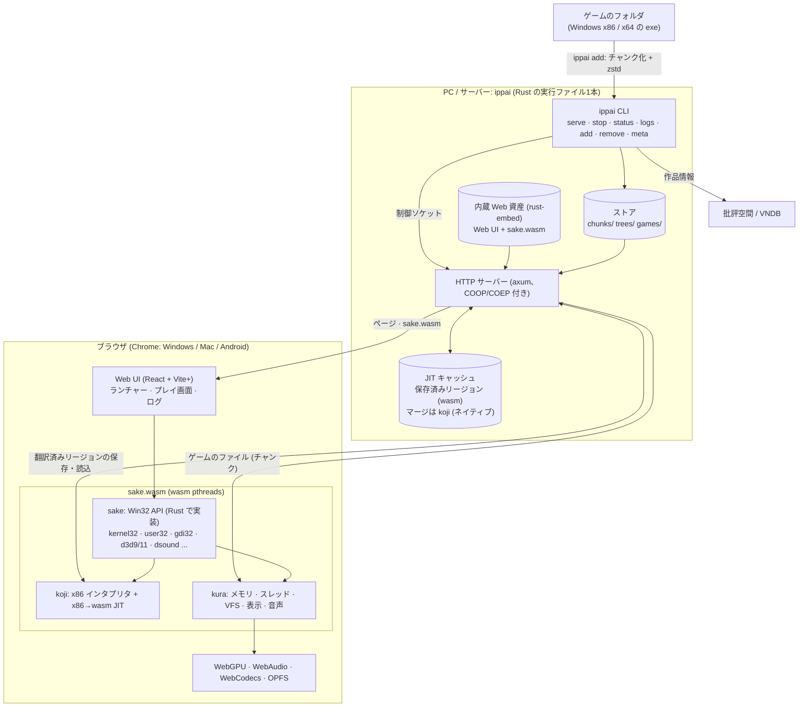

# ippai

ビジュアルノベルをブラウザの中で動かすためのリポジトリです。ゲームの x86 (i386) コードは
x86→wasm JIT (`crates/koji`) で動かし、Windows API は Rust で一から書いた Win32 層
sake (`crates/sake`、[docs/sake.md](docs/sake.md)) が受け持ちます。表示・音声・ファイル・
Direct3D/OpenGL (WebGPU) はブラウザ側のホスト `crates/kura` です。

Wine 11.20 の Unix 側を wasm にする Hangover 方式の経路は 2026-11-02 に廃止を決め、実装・設計
メモ (docs/hangover.md など)・実験結果ごと [a-kaibu/vnvm-wine](https://github.com/a-kaibu/vnvm-wine)
に移しました (履歴もそちらに全部あります)。sake と Wine の比較は [docs/engine-compare.md](docs/engine-compare.md)、
先行研究の調査は [docs/prior-work.md](docs/prior-work.md)、翻訳器は [docs/translator.md](docs/translator.md)、
実行ごとの詳細ログ (クラッシュの原因調査用) は [docs/crashlog.md](docs/crashlog.md) にあります。

以前の QEMU 版 (フルシステム QEMU で Ubuntu 26.04 + Wine を起動する方式) は
[a-kaibu/vnqemu](https://github.com/a-kaibu/vnqemu) に移しました。

## アーキテクチャ



- ゲームの x86 コードは koji が wasm に翻訳してブラウザで直接実行し、Windows API の呼び出しは sake が
  受けます。Wine は使いません。
- ゲームのファイルはサーバーのストアにチャンクで置かれ、kura の VFS が必要な分だけ取りに行きます。
- 翻訳したコード (リージョン) はサーバーに保存され、次回以降の起動と他のゲームの初回起動を速くします。
  事前実行は、まだ誰も遊んでいないゲームを headless Chromium で一度動かしてリージョンを作っておく仕組みです。

## ディレクトリ

| パス | 内容 |
| --- | --- |
| `crates/koji` | i386 CPU コア: インタプリタと x86→wasm JIT (ネイティブ CPU との差分テスト付き) |
| `crates/kura` | ブラウザ側のホスト: メモリ、スレッド、fd、ファイルシステム、表示、音声、Direct3D 9/11・OpenGL (WebGPU) |
| `crates/hlslc` | HLSL コンパイラ: ソース → DXBC (SM4/5)・D3D9 バイトコード (SM2/3)・fx_2_0 エフェクト、D3D9 シェーダーアセンブラ。std のみ |
| `crates/dxwgsl` | シェーダーバイトコード → WGSL: DXBC (SM4/5) と D3D8/9 (vs/ps 1.x〜3.0)、署名の読み取り。std のみ |
| `crates/sake` | Win32 層 (kernel32、user32、gdi32、d3d9 など)。`build.sh` が sake.js / sake.wasm を作る |
| `crates/ippai` | `ippai` 1本のCLI (Web UI を内蔵)。`serve` / `stop` / `status` / `logs`: サーバー (COOP/COEP 付きの配信、JIT リージョンの保存、ゲーム一覧、セーブの S3 バックアップ、実行ログ)。`add`: フォルダをチャンク (256KiB、zstd) のストアにして一覧に登録。`remove` / `meta`: 一覧と、批評空間・VNDB からの作品情報。`pack` / `add-game` は `add` の前半・後半 (非表示) |
| `host/` | emscripten の JS ライブラリ (`pre.js`、`vnfs.js`、`vnjit.js`)、生成スクリプト、テスト用プログラム (`tests/`) |
| `web/` | Vite+ (`vp`) のフロントエンド (TypeScript、UI は React + Tailwind CSS v4 + shadcn/ui、`src/components/ui`): `index.html` (= `play.html`、ゲーム一覧)、`game.html`、`bench.html`、`logs.html` (実行ログ) |
| `tests/` | ヘッドレス Chromium での確認 (`play.mjs`)、Android 相当に遅くして測る (`android-like.sh`)、コーパス |

お気に入り、メモ、プレイ時間の統計、`.ippai` の持ち運び、暗号化 S3 ストレージと SQLite バックアップの手順は [docs/storage.md](docs/storage.md) を参照してください。

## インストール

```sh
curl -fsSL https://raw.githubusercontent.com/a-kaibu/ippai/main/install.sh | sh
```

## 使い方

```sh
ippai serve                       # バックグラウンドで起動して http://localhost:8656 を表示
ippai status | ippai logs --follow | ippai stop
ippai add ./games/sample --exe game.exe   # パック + 一覧に登録 + 作品情報 (--id --title --cover は任意)
ippai remove sample
ippai meta sample | ippai meta --all
```

`ippai serve --foreground` は systemd などから動かすとき用です。保存先 (Linux):
ストア `~/.local/share/ippai/store`、JIT キャッシュ `~/.cache/ippai/jit`、ログ `~/.local/state/ippai/logs`、
設定 `~/.config/ippai/config.toml` (`store` `cache` `logs` `listen`、どれも任意)、制御用ソケット
`$XDG_RUNTIME_DIR/ippai/server-<ストア>.sock` (ストアごとに 1 つ。同じストアで 2 つ目のサーバーは起動しません)。
詳しくは `crates/ippai/src/dirs.rs`。

Web ゲーム (NW.js / Electron) は管理画面と別オリジンで動かすため、サーバーは `--listen` の次のポート
(既定 8657、`--game-listen` で変更) でゲームのファイルだけを配信します。リバースプロキシ越しに使うときは
そのポートも公開し、ブラウザから見える URL が「同じホスト・そのポート」でなければ `--game-url` で指定します
(例: `tailscale serve --bg --https 8657 http://127.0.0.1:8657`)。

## リリース

GitHub の Web 画面だけでできます: **Actions → Release → Run workflow** で patch / minor / major を選ぶと、
svu で次の `vX.Y.Z` を決めて main にタグを打ちます。手で `v*` タグを push しても同じようにリリースされます
(`.github/workflows/release.yml`)。どちらも CI (テスト、sake.wasm と Web のビルド、host/tests) のあと、GoReleaser
(`.goreleaser.yaml`) が Linux x86-64 / ARM64 のバイナリ (cargo zigbuild、Web を rust-embed で内蔵) を作って
スモークテストし、アーカイブ・`checksums.txt`・SBOM を Releases に公開します。ベンチ用ページ (bench.html、
game.html、benchwasm/) はリリースのバイナリには入りません。

## 開発時のビルド

```sh
crates/sake/build.sh              # sake.js / sake.wasm と web/public/sake/
(cd web && vp install && vp build)
cargo build --release -p ippai    # web/dist を埋め込む (debug ビルドは web/dist を直接読む)
target/release/ippai pack ~/prefix32 prefix32   # sake の C:\ (フォント)
target/release/ippai serve --foreground --web web/dist --listen 127.0.0.1:8080
```

sake は今のところ、Wine で作った 32bit prefix (`prefix32`、作り方は vnvm-wine の
`hangover/make-prefix32.py`) の `drive_c` をフォントと、sake にまだない DLL (d2d1、dwrite、
d3dcompiler_47 など) のために使います。ビルド済みのものが共有フォルダの `vnvm-env/` にあります。
Direct3D 10/11 のシェーダーは DXBC から WGSL へ直接翻訳します (`crates/dxwgsl`)。

## 制約

* SharedArrayBuffer が要るので COOP/COEP ヘッダ付き (cross-origin isolated) で配信すること。
* x86 は 32bit のみ。描画は WebGPU のみ (WebGL2/Canvas2D へのフォールバックはしません)。
* DRM (PlayDRM、ソフト電池など) の解析や回避は扱いません。
